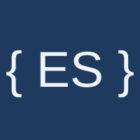

<div align="center">

<p>
  
  
</p>

# ai-assisted-setup-demo

This is a sample repo you can use to get a feel for how you can use AI to
set up [Everscribe](https://everscribe.io) for your codebase with the
[Claude setup skill](https://everscribe.io/docs/quickstart/skill).

</div>

## Sample App matrix

| App | Backend | Frontend | Port |
|---|---|---|---|
| `apps/go` | Gin | React | 9001 |
| `apps/node` | Express | Svelte | 9002 |
| `apps/rust` | Axum | vanilla TS | 9003 |
| `apps/python` | FastAPI | Vue | 9004 |

## Running locally

```bash
make up      # start all apps
make down    # stop all apps
```

Or to run a single app you can run `make dev-go`, `make dev-rust`, etc....